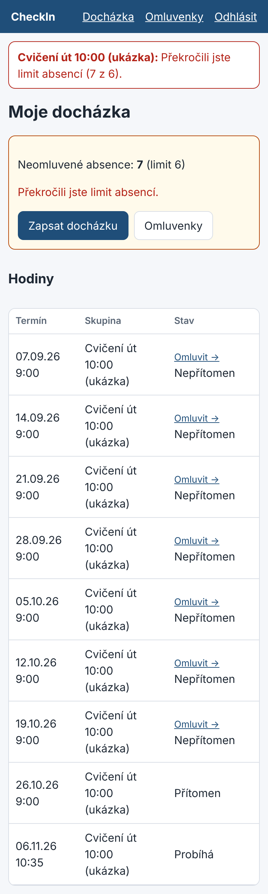
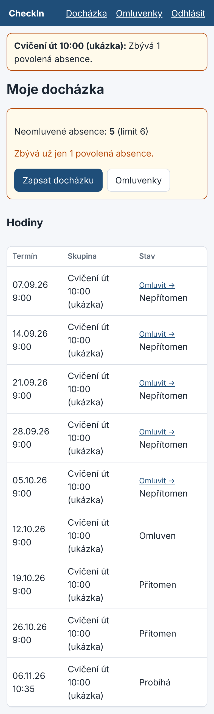
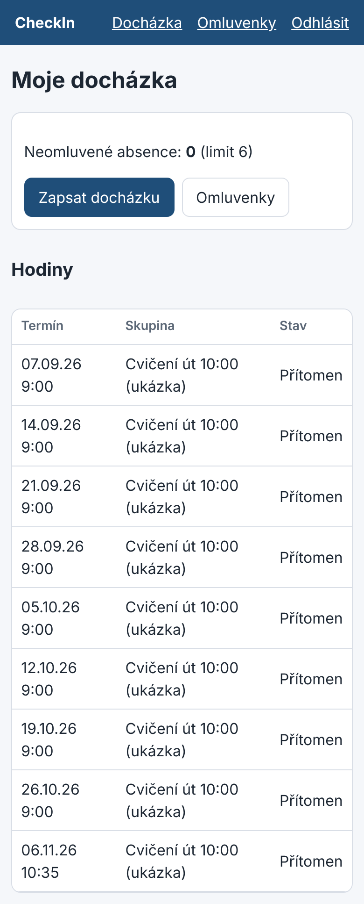

# Pravidla absence

## Co se počítá

| Stav na hodině | Počítá se do limitu? |
|---|---|
| Přítomen | ne |
| Pozdě (více než 10 minut po začátku) | ne |
| **Nepřítomen (bez omluvy)** | **ano** |
| Omluven (schválená omluvenka) | ne |

Hodina, na kterou student nedorazil a která skončila bez záznamu, se automaticky zapíše jako
nepřítomnost.

## Limit

- Povoleno je **6 neomluvených absencí** za semestr.
- Limit se počítá jen z uzavřených hodin.

## Upozornění v aplikaci

| Počet absencí | Co student uvidí |
|---|---|
| 5 | Upozornění: „Zbývá 1 povolená absence.“ |
| 6 | Upozornění: „Zbývá 0 povolených absencí.“ Na přehledu: „Dosáhl jste limitu absencí.“ |
| 7 a více | Upozornění: „Překročili jste limit absencí.“ Učitel vidí studenta ve statistikách označeného jako „Nad limit absencí“. |

## Příklad

Student Bob má 7 absencí. Při 7. absenci se zobrazí upozornění na překročení limitu a učitel ho
uvidí ve statistikách. Pokud by jedna z absencí byla omluvená a schválená, do limitu by se
nepočítala.
