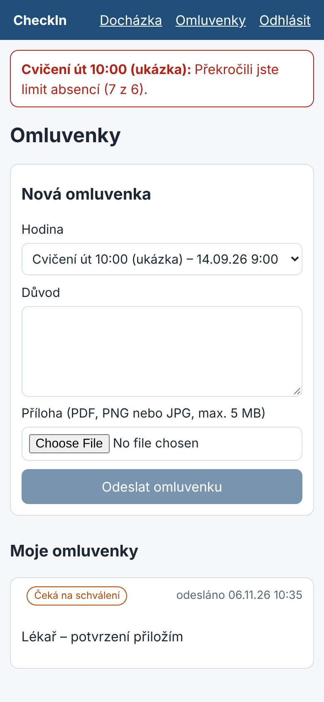

# Student: omluvenky

1. Na stránce **Omluvenky** vyberte hodinu, ke které se omlouváte.
2. Napište důvod (alespoň 3 znaky) a případně přiložte přílohu (PDF, PNG, JPG, do 5 MB).
3. Odešlete. Stav uvidíte v seznamu: čeká na schválení, schváleno, zamítnuto.
4. Po rozhodnutí dostanete upozornění (v aplikaci, na zařízení po zapnutí Web Push).

Omluvenku nelze poslat k hodině, na které jste byli zapsáni jako přítomni, a ke stejné hodině
lze mít jednu aktivní omluvenku.
