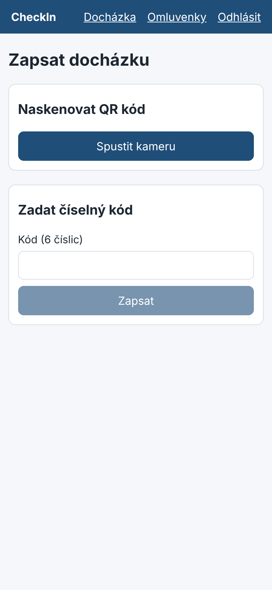
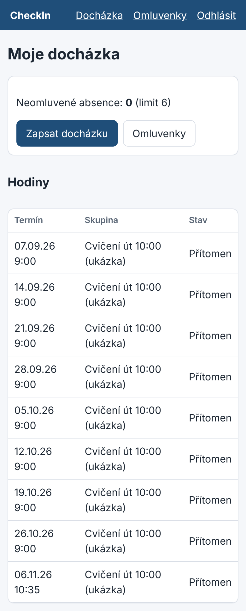

# Student: zápis docházky

1. Na hodině naskenujte QR kód z promítání (tlačítko **Spustit kameru**), nebo zadejte
   6místný číselný kód.
2. Zápis proběhne jen v běžící hodině a jen na zařízení, ze kterého ještě nikdo jiný
   nezapsal docházku.
3. Pokud máte zapnuté sdílení polohy a učebna ji vyžaduje, musíte být ve třídě.

## Přehled absencí

Na úvodní stránce vidíte své hodiny, stav u každé z nich a počet neomluvených absencí
z povolených 6. Hodinu, na kterou jste nebyli, můžete rovnou omluvit tlačítkem **Omluvit**.

