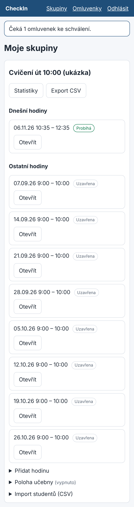
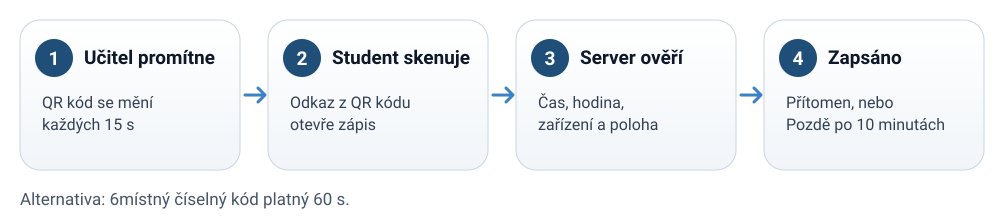
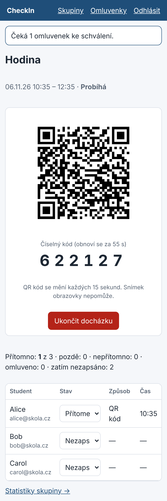

# Učitel: spuštění docházky

## 1. Hodina a skupina

Na úvodní stránce vidíte své skupiny a jejich hodiny. Hodinu přidáte přes „Přidat hodinu“
(začátek a konec). Studenty naimportujete z CSV se sloupci `email,name`.

## 2. Spuštění a QR kód

Tlačítko **Spustit docházku** otevře obrazovku hodiny. Promítněte QR kód na projektor.
- QR kód se mění každých 15 sekund, snímek obrazovky nepomůže.
- Vedle něj je číselný kód (6 číslic, platí 60 s) pro studenty bez funkční kamery.

## 3. Živý přehled

Tabulka se aktualizuje sama. U každého studenta vidíte stav, způsob zápisu (QR, kód, ručně)
a čas. Stav lze změnit přímo v tabulce (přítomen, pozdě, nepřítomen, omluven).

## 4. Ukončení

Tlačítko **Ukončit docházku** hodinu uzavře. Studenti bez záznamu dostanou nepřítomnost.
Hodina se uzavře i automaticky po svém konci.
