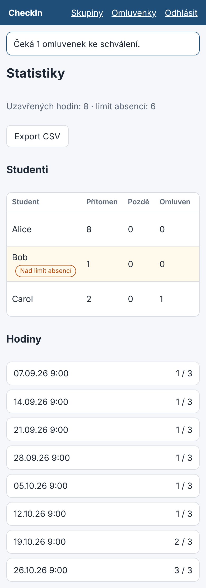
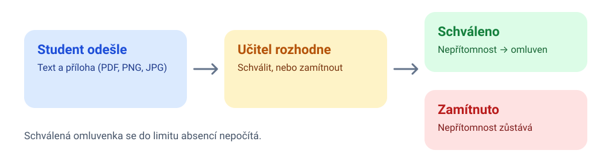
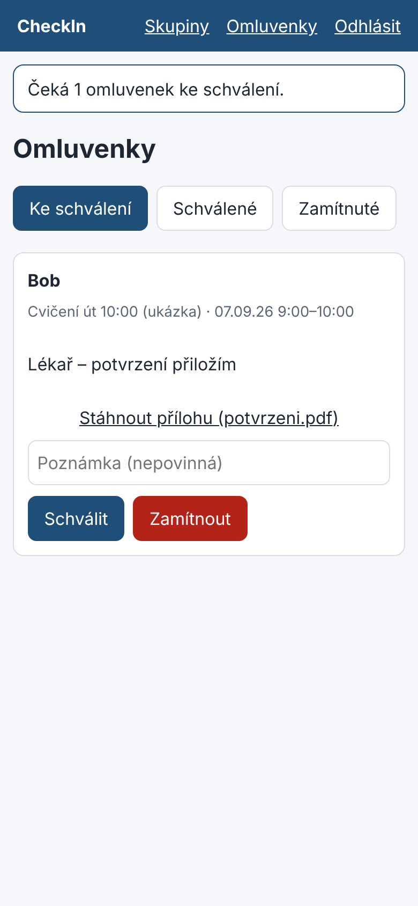

# Učitel: statistiky a omluvenky

## Statistiky skupiny

Tabulka ukazuje u každého studenta počty přítomnosti, pozdních příchodů, omluvených
a nepřítomných hodin. Student, který překročil limit 6 absencí, je zvýrazněn štítkem
**Nad limit absencí**. Export do CSV je tlačítko **Export CSV** nad tabulkou.

## Omluvenky

Studenti posílají omluvenku s textem a přílohou (PDF, PNG nebo JPG, do 5 MB). Vy ji
schválíte nebo zamítnete s poznámkou. Schválená omluvenka změní nepřítomnost na „omluven“
a student tuto absenci nemá v limitu.

